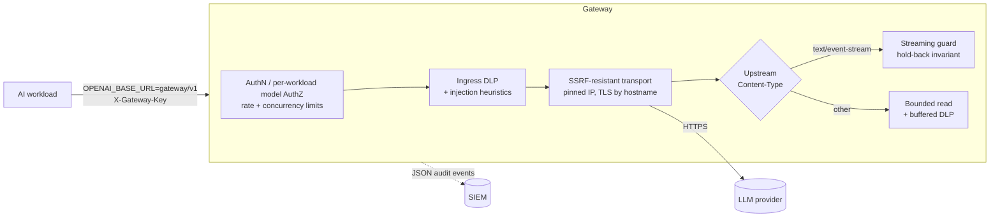

# Shadow AI Governance & Defense

A bi-directional inspection gateway for LLM API traffic. Internal AI workloads call the
gateway instead of the provider. The gateway authenticates each workload, blocks
credentials and known prompt-override phrasings on the way out, forwards the request over
an SSRF-resistant transport, and inspects the response before anything reaches the
workload, including token-by-token **streaming** responses and tool-call arguments.

> **Status: research prototype.** Verified locally: test suite on Python 3.10–3.14,
> container build and hardened run, dependency and container scans. It has **not** been
> exercised against a live LLM provider or in a production cluster, and it has not been
> independently audited. See [docs/LIMITATIONS.md](docs/LIMITATIONS.md).

**Research article:** [Inspecting the Stream: Secret Leakage, Tool Calls and SSRF in LLM Gateways](docs/RESEARCH_ARTICLE.md)

## The problem

"Shadow AI" is the unsanctioned use of LLM APIs inside an organisation. Two failure modes
matter most to a security team:

- **Credential exfiltration through prompts.** Cloud keys, tokens and connection strings
  pasted into prompts, by users or by a manipulated agent, leave the organisation.
- **Credential regurgitation through completions.** A model returns secrets from its
  context, often *streamed* in small fragments or inside tool-call arguments, so that
  per-chunk or single-field filters never see the whole secret.

## What this project contributes

| Area | Design | Evidence |
|---|---|---|
| Streaming DLP | Per-channel hold-back with a stated **release invariant**: no character of a detectable secret is forwarded before it has been inspected, under arbitrary event segmentation, across content, tool-call arguments and multiple choices | Property tests (Hypothesis, 5,000-example profile); 0 leaked characters in 3,900 adversarially segmented streams ([results](docs/BENCHMARK_RESULTS.md#4-streaming-leak-evaluation)) |
| Streaming latency | Hold back only from the earliest *possible* secret prefix (open-prefix grammar), not a fixed window | +27 ms to first content event at 50 tokens/s; total stream time unchanged ([performance](docs/PERFORMANCE_RESULTS.md)) |
| Secret detection | 18 pattern detectors, keyword-context validation and a **length-aware** entropy test using the exact expected entropy `E[H \| n, k]` | Blind held-out: precision 0.925, recall 0.924, FPR 0.081 (n = 3,000) |
| Evaluation | Reproducible synthetic corpus; disjoint seeds **and** templates per split; held-out-only formats; calibration-only thresholds; Wilson intervals; false-positive measurement on 168,548 lines of real code | [docs/BENCHMARK_METHODOLOGY.md](docs/BENCHMARK_METHODOLOGY.md) |
| Outbound safety | Operator-fixed destination; DNS validated at connect time with IP pinning (TLS still verifies the hostname); IPv4-in-IPv6 unwrapping (NAT64, 6to4, Teredo); no redirects; environment proxies ignored | Real-socket, real-TLS and DNS-rebinding tests ([docs/SECURITY_TESTING.md](docs/SECURITY_TESTING.md)) |

## Architecture



A detailed diagram of the full request and response lifecycle is in
[docs/media/architecture-request-lifecycle.png](docs/media/architecture-request-lifecycle.png).
Details: [architecture](docs/ARCHITECTURE.md) · [security design](docs/SECURITY_DESIGN.md) · [threat model](docs/THREAT_MODEL.md)

## Measured results

All figures are reproducible from `benchmarks/results/` and are measured on a synthetic
corpus and one local machine, not on production traffic.

| Measurement | Result |
|---|---|
| Blind held-out detection (`heldout2`, n = 3,000) | Precision 0.925, recall 0.924, F1 0.925; 8.1% of benign samples flagged |
| Streaming leakage (13 cases × 300 adversarial trials) | 0 secret characters leaked in 3,900 trials (95% upper bound ≈ 1.3% per case) |
| Streaming latency at ≈ 50 tokens/s | +27 ms to the first content event; total stream time +1.4 ms |
| False positives on 168,548 lines of real library code | Entropy test 0.209% of lines; pattern and keyword detectors 0.016% |

Failures are reported too: bare random hex is not detected (recall 0), and unseen public
random identifiers are frequently flagged. See [docs/BENCHMARK_RESULTS.md](docs/BENCHMARK_RESULTS.md).

## Quick start

Requirements: Python 3.10 or newer (3.10–3.14 tested) and git.

```bash
git clone https://github.com/gegavirtyt/shadow-ai.git && cd shadow-ai
python -m venv .venv && . .venv/bin/activate        # Windows: .venv\Scripts\activate
pip install -e ".[dev]"
pytest -q                                            # 304 passed, 2 skipped (live-provider tests are opt-in)
```

Run the gateway locally against OpenAI. Workload authentication is required by default.

```bash
export UPSTREAM_API_KEY=<provider key>                # injected server-side; workloads never see it
export GATEWAY_API_KEY=$(python -c "import secrets;print(secrets.token_urlsafe(32))")
python -m shadow_ai_gateway                           # listens on :8080
curl -s localhost:8080/v1/chat/completions -H "X-Gateway-Key: $GATEWAY_API_KEY" \
     -H 'content-type: application/json' -d '{"messages":[{"role":"user","content":"hello"}]}'
```

Point OpenAI-compatible SDKs at the gateway with `OPENAI_BASE_URL=http://<gateway>:8080/v1`
and use the *gateway* key as the SDK API key. For containers, Kubernetes and the full
configuration reference, see [docs/DEPLOYMENT.md](docs/DEPLOYMENT.md).

Security-sensitive defaults: authentication is required (startup fails without workload
credentials), client headers are not forwarded, API docs and test endpoints are disabled,
and audit events contain keyed fingerprints instead of matched values. Set
`AUDIT_HMAC_KEY` so fingerprints correlate across replicas. Never commit a real `.env`.

## Reproducing the evaluation

All test credentials are synthetic and generated at runtime. The evaluation scripts print
their results; add `--out <file>.json` to write a result file comparable with the committed
ones in `benchmarks/results/`.

```bash
python -m benchmarks.corpus                                   # prints the corpus manifest hash
python -m benchmarks.run_dlp_benchmark --splits heldout2      # blind held-out evaluation
python -m benchmarks.streaming_leak_eval --trials 300         # adversarial streaming leaks
python -m benchmarks.code_fp_eval                             # false positives on real library code
python -m benchmarks.perf_benchmark                           # ~10 minutes; process-isolated
python scripts/simulate_attack_defense.py                     # end-to-end attack scenarios
HYPOTHESIS_PROFILE=thorough pytest -q tests/test_streaming_invariant.py   # 5,000 examples
```

Expected values and the evaluation protocol are in
[docs/BENCHMARK_RESULTS.md](docs/BENCHMARK_RESULTS.md) and
[docs/BENCHMARK_METHODOLOGY.md](docs/BENCHMARK_METHODOLOGY.md). Performance figures depend
on hardware; they were measured on one Windows workstation.

## What it does **not** do

- Detect *semantic* prompt injection. The injection check matches known override phrasings
  and their encodings only, and should be treated as telemetry.
- Detect context-free random **hex** secrets (indistinguishable from hashes), or tell random
  public identifiers apart from random secrets without context. These failures are measured,
  not hidden: [error analysis](docs/BENCHMARK_RESULTS.md#3-error-analysis).
- Guarantee anything for secrets its detectors cannot recognise. The streaming invariant
  covers *detectable* secrets.
- Replace network egress controls, provider-side safety features or secret management.

It has not been run against a live provider, in a real Kubernetes cluster, or on a hosted
CI runner. The full list is in [docs/LIMITATIONS.md](docs/LIMITATIONS.md).

## Reporting a vulnerability

Please report suspected vulnerabilities privately, as described in [SECURITY.md](SECURITY.md).
Use synthetic credentials only.

## Repository layout

```
src/shadow_ai_gateway/   gateway package (FastAPI app, detectors, streaming, SSRF transport)
src/proxy_gateway.py     flat compatibility API over the package
tests/                   unit, property-based, integration and real-socket/TLS tests
benchmarks/              corpus generator, evaluation scripts and committed results
infra/                   Kubernetes manifests, IAM policy examples, lab scripts
scripts/                 attack/defense simulation and repository secret scan
docs/                    design, threat model, methodology, results, limitations, article
docs/media/              article figures; regenerate with docs/media/src/make_figures.py
```

## Documentation

| Document | Purpose |
|---|---|
| [docs/RESEARCH_ARTICLE.md](docs/RESEARCH_ARTICLE.md) | Research write-up: design, experiments, results, limitations |
| [docs/ARCHITECTURE.md](docs/ARCHITECTURE.md) | Components, request lifecycle, module map |
| [docs/THREAT_MODEL.md](docs/THREAT_MODEL.md) | Assets, adversaries, trust boundaries, control mapping |
| [docs/SECURITY_DESIGN.md](docs/SECURITY_DESIGN.md) | Design and correctness arguments for each control |
| [docs/SECURITY_TESTING.md](docs/SECURITY_TESTING.md) | Test strategy and what each suite establishes |
| [docs/BENCHMARK_METHODOLOGY.md](docs/BENCHMARK_METHODOLOGY.md) · [docs/BENCHMARK_RESULTS.md](docs/BENCHMARK_RESULTS.md) | DLP evaluation protocol and results |
| [docs/PERFORMANCE_RESULTS.md](docs/PERFORMANCE_RESULTS.md) | Latency, throughput, resource measurements |
| [docs/LIMITATIONS.md](docs/LIMITATIONS.md) | Known limitations and residual risk |
| [docs/DEPLOYMENT.md](docs/DEPLOYMENT.md) | Configuration reference, container, Kubernetes |
| [CONTRIBUTING.md](CONTRIBUTING.md) · [SECURITY.md](SECURITY.md) | Contribution workflow · vulnerability reporting |

## License

Copyright 2026 Virtyt Gega. Licensed under the [Apache License, Version 2.0](LICENSE).
The software is provided "as is", without warranties or conditions of any kind; see the
license for details.
