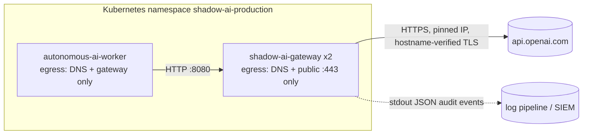
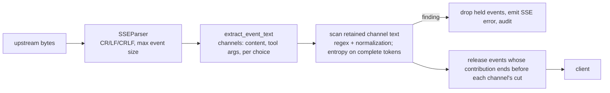

# Architecture

## 1. Deployment view

The gateway is a **reverse proxy for one LLM API** (OpenAI-compatible chat completions by
default). Workloads use it as their API base URL; it is *not* an HTTP CONNECT forward proxy.
The upstream URL is fixed by the operator; clients cannot choose a destination.

## 2. Module map (`src/shadow_ai_gateway/`)

| Module | Responsibility | Depends on |
|---|---|---|
| `config.py` | Immutable `Settings`, env parsing, **startup validation** (refuses unsafe config) | auth, detectors |
| `auth.py` | Workload credentials (SHA-256 digests), constant-time multi-key verification, model allowlists | – |
| `entropy.py` | Shannon entropy, exact expected entropy of random strings, randomness test | – |
| `normalization.py` | Bounded decoding variants (NFKC, HTML, URL×3, escapes, Unicode tags, invisible chars, Base64/hex) | – |
| `detectors.py` | Detector registry, generic entropy detector, injection heuristics, open-prefix grammar | entropy, normalization |
| `inspection.py` | Strict JSON parsing, field policy, ingress/buffered-egress inspection, client-facing descriptions | detectors |
| `streaming.py` | Byte-level SSE parser, per-channel `StreamGuard`, `guarded_sse` pipeline | detectors |
| `ssrf.py` | IP policy, URL policy, `SSRFProtectedBackend`/`Transport`, client factory | – |
| `providers.py` | Header allowlists, credential injection (OpenAI/Anthropic/generic), defaults | – |
| `limits.py` | Concurrency limiter, per-workload token-bucket rate limiter | – |
| `audit.py` | Structured audit events with keyed fingerprints | detectors |
| `app.py` | FastAPI factory, request lifecycle, streaming response with guaranteed cleanup | all |

`src/proxy_gateway.py` is a compatibility facade exposing a flat, single-module function API
on top of the package; `scripts/` contains the attack simulation and the repository secret scan;
`benchmarks/` contains the evaluation suite.

## 3. Request lifecycle (`app.py`)

| Step | Control | Failure |
|---|---|---|
| 1 | Authenticate workload (`X-Gateway-Key` or `Authorization: Bearer`) | 401 + audit `AUTH_VIOLATION` |
| 2 | Per-workload rate limit (token bucket, per replica) | 429 + `Retry-After` |
| 3 | Concurrency admission (slot held until the response/stream is finished) | 503 + `Retry-After` |
| 4 | `Content-Type: application/json`, bounded body read with timeout | 415 / 413 / 408 |
| 5 | Strict JSON: UTF-8, no duplicate keys, depth ≤ 64, object at top level | 400 |
| 6 | Ingress DLP on every string value **and key**; injection heuristics per mode | 403 + `INGRESS_VIOLATION` |
| 7 | Model authorization (global and per-workload `fnmatch` patterns) | 403 + `AUTHZ_VIOLATION` |
| 8 | Build upstream request from **allowlisted** headers; inject provider credential server-side | – |
| 9 | Send over SSRF-protected transport (no redirects, no env proxies) | 502/504, `SSRF_BLOCKED` |
| 10 | Upstream `3xx` → never followed | 403 (policy-violating target) / 502 |
| 11 | Upstream `text/event-stream` + 2xx → `StreamGuard` | SSE error event + `EGRESS_DLP_LEAK` |
| 12 | Anything else → bounded read (8 MiB) + buffered DLP, **all status codes** | 403 / 502 |

The egress branch (11 vs 12) is chosen from the **upstream response's** Content-Type,
never from the client's `stream` flag.

## 4. Streaming pipeline (`streaming.py`)

Events are forwarded **unmodified and in order**; the guard only decides *when* each
event may be released. The cut rule and its correctness argument are in
[SECURITY_DESIGN.md §3](SECURITY_DESIGN.md#3-streaming-egress-inspection-streamingpy).

## 5. State and concurrency

* No mutable module-level state in the request path; each `create_app(settings)` owns its
  `GatewayState` (client pool, limiters, audit logger). Tests build isolated gateways.
* Limiters are mutated only on the event-loop thread without awaits between check and
  update, so they need no locks. They are **per replica** (see LIMITATIONS.md).
* Streaming responses own their concurrency slot and upstream connection; release happens
  in a cancellation-shielded `finally`, even if the client disconnects before the body starts.
