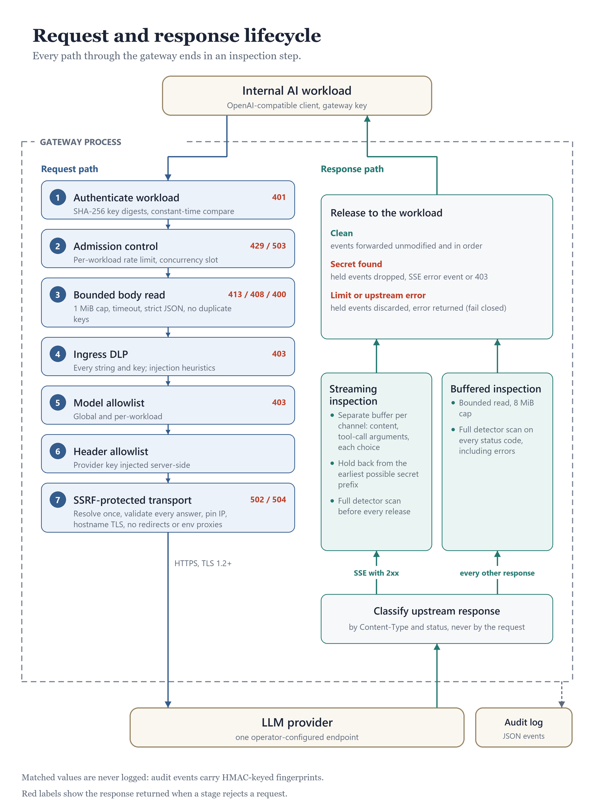
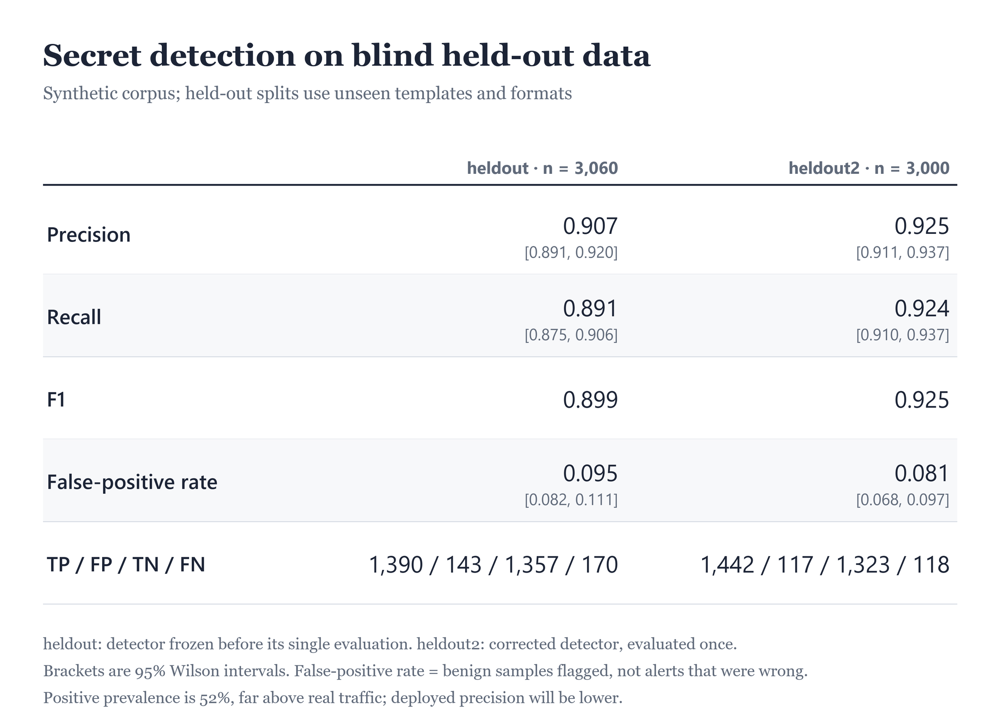
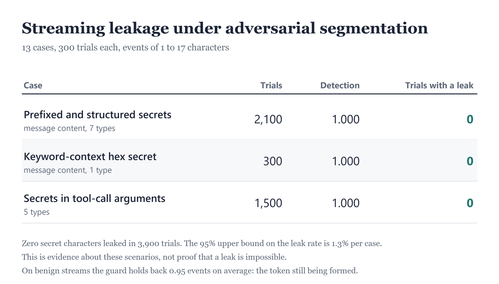
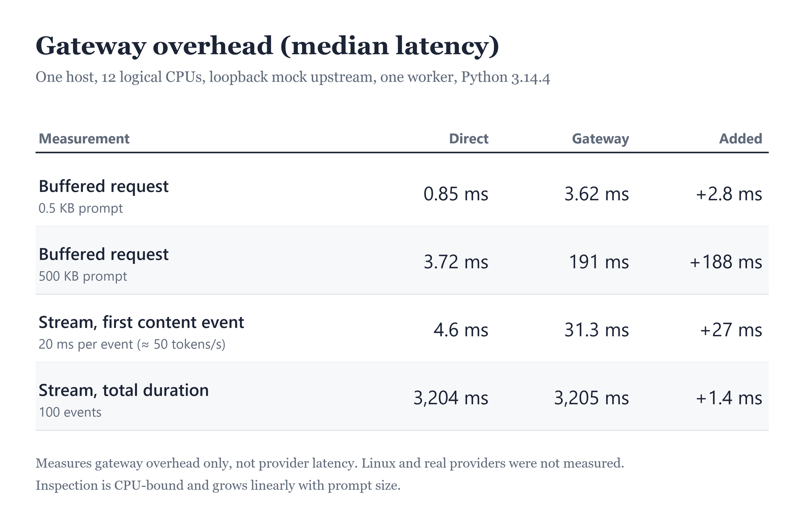

# Inspecting the Stream: Secret Leakage, Tool Calls and SSRF in LLM Gateways

### A streaming inspection design with a stated safety argument, evaluated on blind held-out data, with its failures reported alongside its successes

**Code, tests and data:** <https://github.com/gegavirtyt/shadow-ai>

---

## 1. Introduction

Many organisations now route their applications' LLM traffic through a gateway. It
authenticates workloads, scans prompts for credentials, restricts which models may be
used and keeps an audit trail. The common mental model is simple: run secret detectors
over the prompt and block on a match.

That model covers only part of the traffic. Models also answer, and a model with
retrieval, tools or a long conversation history can repeat credentials it has seen. Its
answers rarely arrive as one string. They are streamed as dozens of small server-sent
events, spread across parallel choices, or embedded as JSON inside tool-call arguments.
A detector that works perfectly on a complete string protects nothing if the secret
reaches the client one fragment at a time.

This article describes *Shadow AI Governance & Defense*, an open-source FastAPI gateway
that inspects both directions of LLM traffic, including streams, and measures how well it
does so. The research question is:

> **How can a gateway inspect prompts and responses without secrets escaping through
> streaming, tool calls or alternative response paths, and without adding unacceptable
> latency?**

The contribution has three parts: a streaming inspection design with an explicit release
rule and safety argument; an evaluation on held-out data the detector was never tuned on;
and a plain account of what the approach cannot do. The gateway is a research prototype,
verified locally and in continuous integration, not independently audited or
peer-reviewed. Every number below comes from a script, test or result file in the
repository.

## 2. The security problem and threat model

Ingress inspection, which stops a password being pasted into a prompt, is the familiar
case ([OWASP LLM02:2025](https://genai.owasp.org/llmrisk/llm022025-sensitive-information-disclosure/)).
The harder failures are paths on which the detectors never run:

- **Path selection.** A gateway that chooses its egress path from the *client's* `stream`
  flag, rather than from the upstream response, can be steered around its stream filter.
- **Partial coverage.** Inspecting only HTTP 200 bodies lets error bodies through;
  inspecting only `choices[0].delta.content` ignores tool-call arguments and other choices.
- **Streaming.** Events are often single tokens of two to six characters, so a
  40-character key spans about ten events, and no single event contains it.
- **The gateway itself.** It holds provider keys, makes outbound HTTPS requests and parses
  untrusted JSON. Fail-open authentication, unbounded reads or a server-side request
  forgery (SSRF) path turn the control point into the weakness.

The threat model assumes five adversaries: a compromised or prompt-injected **workload**
that sends arbitrary, possibly obfuscated JSON with a valid key; **model output** that
controls completion content *and* how it is segmented into events, channels and tool
calls; a **network or DNS attacker** on the gateway's egress path who controls DNS answers
and can return redirects; an **unauthenticated client** that can reach the gateway port;
and a **resource-exhaustion** attacker sending large, slow or deeply nested requests, or
serving endless streams. A compromised gateway host, a malicious operator and a
compromised provider (beyond controlling its output) are out of scope.

## 3. Gateway architecture

The gateway is a **reverse proxy for one operator-configured LLM endpoint**: clients cannot
choose the destination. Figure 1 shows the full lifecycle of a request.



*Figure 1. Request path (left), response path (right) and the boundaries of the gateway
process. Red labels are the responses returned when a stage rejects a request.*

Two invariants carry most of the security weight. First, the egress branch is selected
from the **upstream response**, by its content type and status, never from the client
request. Second, every branch ends in an inspection step: streamed responses go through
the streaming inspector, and everything else is read with an 8 MiB cap and scanned
whatever its status code.

Defaults fail closed. Unless authentication is explicitly disabled, the gateway refuses to
start without workload credentials. It rejects
duplicate JSON keys (which would let it inspect one value while the provider uses
another), forwards only allowlisted headers and injects the provider key server-side.
Audit events carry HMAC-keyed fingerprints in place of matched values.

## 4. Streaming DLP and the release safety argument

### Why a fixed window is not enough

The obvious design holds back the last *W* characters, with *W* larger than the longest
secret. It fails for three reasons. Secrets that contain whitespace, such as a PEM
private-key block, `api_key = ⟨value⟩` or `Bearer ⟨token⟩`, can exceed any fixed *W*.
"Longest secret" is undefined for connection strings or service-account JSON. And every
stream is delayed by *W* characters, even when no secret is anywhere near.

The useful question is not how long a secret can be, but **how much of its beginning a
detector needs to see before the secret is recognisable**.

### Channels and the release rule

The guard inspects each **channel** separately. A channel is a JSON path within the
event, with list positions replaced by the element's `index`, so interleaved choices and
parallel tool calls each get their own buffer and a secret cannot be split across them.

For each channel it computes two positions:

- **`r`**, the start of the trailing non-whitespace run: the token still being formed. It
  is not released while it is still forming.
- **cut**, the earliest position `s` in `[r − W, r)` from which `text[s:r]` fully matches
  `OPEN_PREFIX_RE`, or `r` if there is none. `OPEN_PREFIX_RE` is the union of the prefix
  grammars of every detector that can match whitespace, such as `-----BEGIN RSA PRIVATE `,
  `password: ` and `Bearer `. `W` defaults to 64 and cannot be set below 50.

An event is released only when every channel's contribution ends at or before that
channel's cut. Released events are forwarded unmodified and in order. Before each release
decision, the full detector set scans the retained text; a match drops all held events,
sends an SSE error event and writes an audit record. Here is a trace replayed through the
real guard with a synthetic value:

```
event        retained text            r    open prefix?    released
"The"        The                      0    –               –
" config"    The config               4    no              "The"
" uses"      The config uses         11    no              " config"
" api_key"   … uses api_key          16    no              " uses"
" ="         … api_key =             24    yes (from 16)   –
" 7f3a…"     … api_key = 7f3a…       26    yes             –
…            value recognisable       –    –               detector fires: held
                                                           events dropped, SSE error
```

Ordinary text flows almost immediately; holding starts only where a secret could begin.
In this replay a 40-character hex value was detected after 24 of its characters had
arrived, and none of them was released.

### The safety argument

The property is: **no character of a detectable secret is released.** It rests on two
preconditions about the detectors:

- **(P1)** A match contains no whitespace, or all of its whitespace lies within a prefix
  of length at most `W`.
- **(P2)** `OPEN_PREFIX_RE` fully matches every whitespace-terminated prefix of such a
  match.

Suppose some character of an incomplete secret had been released. Then the secret starts
before the cut. If it contains no whitespace, it lies inside the trailing run beginning at
`r`, which is never released. If it does contain whitespace, P1 places its start within
`W` of `r`, and P2 means the grammar matches from that start; since the cut is the
*earliest* such position, the cut cannot lie after the start. Both cases contradict the
assumption. Complete secrets are caught by the scan that precedes every release.

This argument is conditional on P1 and P2 and is informal: it is **not a machine-checked
proof**. The preconditions and the end-to-end property are tested with
[Hypothesis](https://hypothesis.readthedocs.io/en/latest/) (300 examples per test by
default, 5,000 under a `thorough` profile). One test checks P1 for every detector, one
checks P2, one checks that every whitespace-bearing detector declares a prefix grammar,
and `test_no_secret_character_is_released` streams secrets under arbitrary event *and*
transport segmentation across content, tool-call and noise channels. The tests did real
work: Hypothesis found that `api key is: ⟨value⟩` was not covered, and the detector and
grammar were corrected together.

The guarantee has a boundary. Entropy detection and keyword-context validation are
statistical; keyword validation misses an estimated 0.1–0.6% of random values (Monte
Carlo, n = 20,000). For these detectors the tested claim is weaker: **streaming never
detects less than buffered inspection of the same text.** Secrets the detectors cannot
recognise at all are outside the guarantee entirely.

The SSE parser follows the [WHATWG rules](https://html.spec.whatwg.org/multipage/server-sent-events.html)
at byte level. Held text, event size, total bytes and duration are all bounded, and any
limit, upstream error or timeout discards held events, so the guard fails closed.

## 5. Credential detection and SSRF protection

### Detection

Detection combines three kinds of evidence: 18 pattern detectors supply format and
context, and an entropy test supplies randomness. **Format:** cloud keys and session
tokens, source-control, chat-platform, LLM-provider and payment keys, PEM private-key
headers, database URLs with passwords and `Bearer` values. **Context:** keyword
assignments such as `secret = …` and `password: …`, with placeholders like `${VAR}` or
`your_key_here` suppressed. **Randomness:** a length-aware entropy test.

Fixed entropy thresholds such as 4.5 bits per character cannot flag hexadecimal, whose
maximum is 4 bits, or any token shorter than 23 characters. The gateway instead compares
each token's entropy *H* with the **exact expected entropy of a uniformly random string of
the same length *n* over an alphabet of size *k***:

```
E[H | n, k] = −k · Σ_{c=1..n} P(Bin(n, 1/k) = c) · (c/n) · log₂(c/n)
```

A token is treated as random if `H ≥ E[H] − δ`, with δ = 0.25 without context and 0.40 next
to a keyword. Both margins were chosen on a calibration split only, by a rule fixed in
advance: maximise recall subject to a calibration false-positive rate of at most 1%.
Candidates must also be at least 20 characters, mix character classes and not match
known public formats. Bounded normalisation (Unicode, URL, HTML, escapes, Base64 and hex)
adds scan variants without altering forwarded bytes.

One limit is irreducible. A random 40-character hex string looks the same whether it is
an API secret or a SHA-1 commit hash, so the gateway does **not** flag bare random hex,
but does flag hex next to a keyword. The reverse problem also exists: public random
identifiers look like secret tokens. Pattern and keyword detectors always block;
the entropy test can be set to `block` (default), `log` or `off`. In `log` mode entropy is
**not evaluated in streams at all**, so choosing it weakens enforcement.

### SSRF-resistant transport

At startup the gateway refuses a non-allowlisted upstream host, credentials in the URL and
plain HTTP outside mock mode. At connection time a custom httpcore network backend
re-checks the allowlist, resolves the hostname **once**, validates **every** answer (one
forbidden answer rejects the connection) and connects to a validated IP literal. With no
second lookup, DNS rebinding between check and use cannot redirect the socket.

Blocked destinations include link-local addresses such as cloud metadata, private,
loopback, carrier-grade NAT, multicast, reserved and documentation ranges, and IPv4
addresses embedded in IPv6: mapped forms, [6to4](https://www.rfc-editor.org/rfc/rfc3056),
[Teredo](https://www.rfc-editor.org/rfc/rfc4380) and
[NAT64](https://www.rfc-editor.org/rfc/rfc6052). `64:ff9b::a9fe:a9fe`, the NAT64 form of the
metadata address, is rejected. The client never follows redirects, ignores proxy
environment variables and `.netrc`, requires TLS 1.2 or later and does not retry (see the
[OWASP SSRF Prevention Cheat Sheet](https://cheatsheetseries.owasp.org/cheatsheets/Server_Side_Request_Forgery_Prevention_Cheat_Sheet.html)).

IP pinning is **not** certificate pinning: TLS still verifies the provider's hostname, so
any trusted certificate authority can issue for it unless `UPSTREAM_CA_BUNDLE` narrows
trust. A 46-test transport suite, much of it using real sockets and real TLS with a
throwaway certificate authority, shows that wrong-host and untrusted certificates are rejected
and that forbidden answers are refused before any socket opens. The DNS-rebinding test
uses a simulated resolver, so it establishes a property of the code path, not of real DNS
infrastructure.

## 6. Experimental methodology

**Tests.** The suite contains 304 passing tests plus 2 live-provider tests that are
skipped unless explicitly enabled. It spans unit and property tests, integration tests
against real HTTP servers, transport tests with real sockets and TLS, streaming property
tests and regression suites, and reaches 90% branch coverage. It passes locally on
Windows (Python 3.14) and in continuous integration on GitHub-hosted Linux runners
(Python 3.10 to 3.14). Coverage measures exercised code, not resistance to attacks
nobody wrote a test for.

**Corpus.** Detection is evaluated on a synthetic corpus with labels assigned **by
construction**: a sample is positive if and only if a credential was embedded, never
according to what the detector reports. Values are generated at runtime with correct
prefixes, lengths and alphabets, so no secret-shaped literals are committed, and the
corpus is reproducible bit for bit, identified by a manifest hash. It spans 22 credential
categories and 20 hard-negative categories, including digests, commit hashes, UUIDs, SRI
hashes, Base64 prose, public keys and placeholders. Bare random hex is included as a known
failure.

Four splits use disjoint random seeds **and** disjoint template pools: *development*
(1,260 samples) for engineering, *calibration* (1,260) only for choosing entropy margins,
and two held-out splits, *heldout* (3,060) and *heldout2* (3,000), built from contexts such
as logs, CSV, stack traces, Terraform, SQL and diffs. Each held-out split also adds
**credential and identifier formats that appear in no other split**, so the evaluation
tests generalisation to unseen contexts *and* unseen formats.

**Protocol.** With the detector frozen, *heldout* was evaluated once. That run exposed a
tokenisation defect (tokens immediately after `=` were never evaluated). It was fixed,
together with an exemption for inline `shaNNN-` digests in the family of an existing one;
the other format-specific false positives were not tuned away. Because *heldout* was no longer
blind, *heldout2* was defined before its single evaluation. *heldout2* is therefore a
blind test of the corrected detector. The *heldout2* numbers can be regenerated from the
repository. The *heldout* figures come from the detector before the fix, on an earlier
corpus build, so they cannot be regenerated from the published code, and the order of
evaluation is documented but cannot be verified from the public repository alone.

**Streaming leaks.** Thirteen cases (8 secret types in message content, 5 in tool-call
arguments), 300 trials each. A synthetic secret is embedded in random prose and cut into
events of 1 to 17 characters; the evaluation records detection and whether any secret
character reached the client.

**Other measurements.** False positives on 168,548 lines of nine widely used Python
libraries, which contain no credentials; and performance with upstream, gateway and load
generator as separate processes on one Windows 11 host.

## 7. Results and performance

### Secret detection



*Figure 2. Detection on the two blind held-out splits, with 95% Wilson intervals. The
heldout column was measured with the detector before the tokenisation fix.*

On *heldout2* the gateway reached precision 0.925 and recall 0.924, with 8.1% of benign
samples flagged. Two cautions apply. The false-positive rate is the share of *benign
samples* flagged, not the share of alerts that were wrong. And the corpus is about 52%
positive, far above real traffic, so precision in deployment will be lower.

The errors are concentrated rather than diffuse. Of the 50 categories in *heldout2*, 42
also appear in development, and all of them had **zero errors** except bare random hex,
the expected failure. All 117 false positives
came from two unseen categories of public random identifiers: bech32 addresses (58 of 60
flagged) and file-sharing IDs (59 of 60). The 118 false negatives were bare hex (60 of 60,
by design), an unseen vendor token with a hex body (56 of 60) and one each in two other
unseen formats. Generalisation across *contexts* works; generalisation to unseen
random-looking *formats* does not.

### Streaming leakage



*Figure 3. Streaming leakage under adversarial segmentation.*

No secret character reached the client in any of the 3,900 trials, and every secret was
detected. With 300 trials per case, the 95% upper bound on the leak rate is about 1.3% per
case. This is evidence about these thirteen scenarios, **not proof** that a leak is
impossible. On benign streams the guard held back 0.95 events on average: essentially
only the token still being formed.

### False positives on real code

On 168,548 lines of library code, the generic entropy test flagged 352 lines (0.209%,
95% CI 0.19–0.23%) and the pattern and keyword detectors flagged 27 (0.016%). Assuming
independent lines, the entropy rate implies roughly a **one-in-three chance of a false
block per 200-line paste**. Most hits are long camel-case identifiers. For coding
assistants, this is the main usability limit, and the reason the entropy test can be
switched to `log`.

### Performance



*Figure 4. Gateway overhead on one host (medians over 40 to 300 requests per row).*

At about 50 tokens per second, the streaming guard adds roughly one inter-token interval
(+27 ms) before the first content event and nothing measurable over the whole stream.
Buffered inspection is CPU-bound, about 0.37 ms per KB of prompt, so a 500 KB prompt costs
188 ms. A single worker sustained about 236 requests per second with 8 concurrent clients
on 0.5 KB prompts. These figures characterise gateway overhead on one machine; provider
latency, Linux hosts and multi-worker deployments were not measured.

## 8. Limitations and threats to validity

**Detection.** Bare random hex is undetectable without context. Unseen vendor formats
with hex bodies are mostly missed until a detector is added. Public random identifiers
such as cryptocurrency addresses and file-sharing IDs are flagged at high rates. Code-heavy
traffic produces frequent false blocks in `block` mode. Keyword-context validation is
statistical. Base64 longer than 8,192 characters or nested more than two levels deep is
not decoded. Encryption, custom ciphers and steganography are out of scope.

**Prompt injection.** The heuristic recognises **known phrasings** and their encodings
only. Paraphrased, multilingual, semantic and indirect injection are not detected, and
pattern matching cannot solve semantic injection
([OWASP LLM01:2025](https://genai.owasp.org/llmrisk/llm01-prompt-injection/)). It is
telemetry, not a defence; real mitigations are privilege separation for agents,
authorisation of tool calls and provider safety features.

**Streaming.** The guarantee covers detectable secrets only. A detection ends the whole
stream, and text released before it stays with the client. A whitespace-free run longer
than 16,384 characters ends the stream.

**Evidence.** The corpus is synthetic, built from hand-written templates with labels by
construction, by a single author. Unseen categories are few (60 samples each) and
prevalence is unrealistically high. Organisations should validate on their own traffic
before relying on these rates. Performance was measured on one Windows workstation.

**Operations.** The container base image is pinned by tag, not by digest. Rate and
concurrency limits apply per replica. Behind an ingress, the
audited client IP is the ingress address. AWS Bedrock request signing is not supported.

**Verified in continuous integration.** The CI workflow runs on GitHub-hosted Linux
runners: the test suite on Python 3.10 to 3.14, static analysis, dependency and secret
checks, the *heldout2* and streaming evaluations, a container build with a hardened smoke
test, a container vulnerability scan and schema validation of the Kubernetes manifests.

**Not established.** Live provider traffic; deployment in a real Kubernetes cluster (the
manifests are schema-validated only); mutation testing; production deployment; an
independent security audit; peer review.

## 9. Deployment and reproducibility

The gateway ships as a non-root container built from a hash-pinned lock file; the
included Kubernetes manifest drops all capabilities and mounts the root filesystem
read-only. The security-sensitive settings are few: provide workload credentials and an
`AUDIT_HMAC_KEY`, keep mock mode and test endpoints disabled, and choose deliberately
between `block` and `log` for entropy detection.

Everything in this article can be reproduced from the repository. Its README lists the
commands for the tests, the corpus hash and each evaluation:

**<https://github.com/gegavirtyt/shadow-ai>**

The methodology, per-category results, threat model and design arguments are in its
`docs/` directory. All test credentials are synthetic and generated at runtime.

## 10. Conclusion

A gateway can inspect streamed LLM responses, including tool-call arguments and parallel
choices, under an explicit release rule whose assumptions are stated and property-tested.
In this evaluation it leaked no secret characters across 3,900 adversarially segmented
streams, at a cost of about one inter-token interval before the first token. The same
evaluation marks where pattern and entropy detection stops working: context-free hex,
unseen public identifiers and code-heavy text.

The broader lesson concerns coverage more than detection quality. The most serious ways
for a gateway to fail are the paths on which its detectors never run: an unexpected
content type, an error status, a second choice, a tool-call argument, an unbounded read.
A gateway is a security control only if it covers the whole request–response lifecycle,
and claims about it deserve trust only when the evidence, including the failures, is
published with them.

What remains open is everything outside the lab: real provider streams, real clusters,
real secret prevalence and adversaries who have read this article. Those are the next
experiments.

---

## References

1. OWASP Foundation. *LLM02:2025 Sensitive Information Disclosure.* OWASP Top 10 for LLM Applications. <https://genai.owasp.org/llmrisk/llm022025-sensitive-information-disclosure/>
2. OWASP Foundation. *LLM01:2025 Prompt Injection.* OWASP Top 10 for LLM Applications. <https://genai.owasp.org/llmrisk/llm01-prompt-injection/>
3. OWASP Cheat Sheet Series. *Server-Side Request Forgery Prevention Cheat Sheet.* <https://cheatsheetseries.owasp.org/cheatsheets/Server_Side_Request_Forgery_Prevention_Cheat_Sheet.html>
4. WHATWG. *HTML Living Standard: Server-sent events.* <https://html.spec.whatwg.org/multipage/server-sent-events.html>
5. Bao, C., Huitema, C., Bagnulo, M., Boucadair, M., Li, X. *RFC 6052: IPv6 Addressing of IPv4/IPv6 Translators.* IETF, 2010. <https://www.rfc-editor.org/rfc/rfc6052>
6. Carpenter, B., Moore, K. *RFC 3056: Connection of IPv6 Domains via IPv4 Clouds.* IETF, 2001. <https://www.rfc-editor.org/rfc/rfc3056>
7. Huitema, C. *RFC 4380: Teredo: Tunneling IPv6 over UDP through Network Address Translations (NATs).* IETF, 2006. <https://www.rfc-editor.org/rfc/rfc4380>
8. MacIver, D. R., Hatfield-Dodds, Z., et al. *Hypothesis: property-based testing for Python.* <https://hypothesis.readthedocs.io/en/latest/>

---

AI-assisted tools were used for editorial assistance. The author is responsible for the technical content, research interpretation, and reported results.
